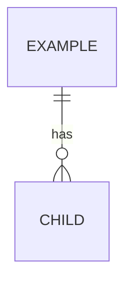

# Database Schema (global view)

Maintained by `/db-design`. Table details live in each `docs/modules/<module>/db.md`. Rules: `.claude/rules/database.md`.

## ERD

## Table index

| Table | Module | Purpose |
| ----- | ------ | ------- |
