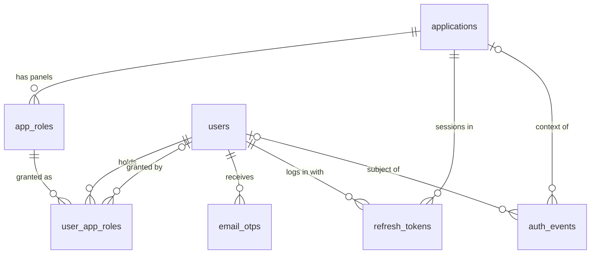

# Database Schema (global view)

Maintained by `/db-design`. Table details live in each `docs/modules/<module>/db.md`. Rules: `.claude/rules/database.md`.

MySQL 8.4 (8.0.16+ required), InnoDB, `utf8mb4` / `utf8mb4_0900_ai_ci` by default, DATETIME in UTC. Lengths, enum values and format patterns are shared with Zod through `shared/src/limits.js` and `shared/src/enums.js`.

## ERD

## Table index

| Table            | Module | Purpose                                                                                   |
| ---------------- | ------ | ----------------------------------------------------------------------------------------- |
| `applications`   | auth   | Connected products (fyinder, real_estate); client secret hash; disabled, never deleted    |
| `app_roles`      | auth   | Panels of an application, with registration mode (OPEN / INVITE_ONLY)                     |
| `users`          | auth   | One row per person: email, password hash, name, status, public `uuid`, `profile_version`  |
| `user_app_roles` | auth   | Panel access: one row per person and panel, with status and how it was granted            |
| `email_otps`     | auth   | One-time codes (stored as HMAC) for email verification, password reset and account setup  |
| `refresh_tokens` | auth   | Sessions: one login into one application, hashed refresh tokens with rotation families    |
| `auth_events`    | auth   | Security event log (logins, lockouts, grants, token reuse)                                 |

Details: [docs/modules/auth/db.md](../modules/auth/db.md).
