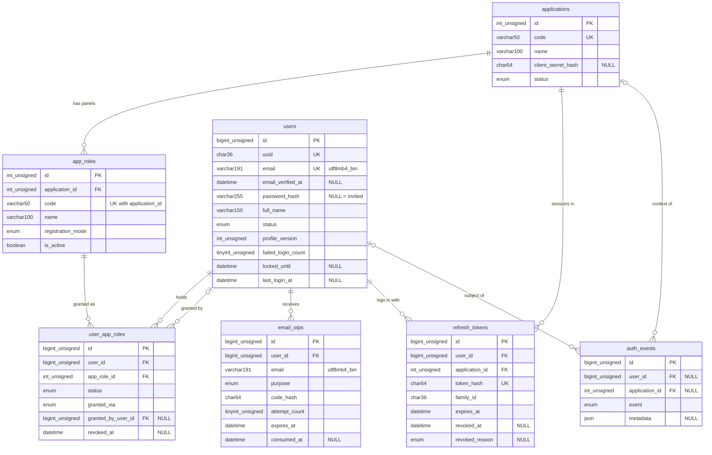

# Auth – Database

Produced by `/db-design` (approved by the user, 2026-11-07), to be reviewed by `/db-design-review`. Global view: [docs/database/SCHEMA.md](../../database/SCHEMA.md). Decisions: [DEC-002](../../DECISIONS.md), [AUTH-DEC-001..008](../../execution/auth/decisions/).

Conventions for every table: InnoDB, `DEFAULT CHARSET utf8mb4 COLLATE utf8mb4_0900_ai_ci`, `DATETIME` in UTC, names `idx_`/`uq_`/`fk_`/`chk_<table>_<cols>`. Lengths come from `LIMITS` (`shared/src/limits.js`), enum values from `shared/src/enums.js`, format patterns from `PATTERNS` (`shared/src/limits.js`). Every `ON UPDATE` is `CASCADE` (AUTH-DEC-001). Every `created_at` gets `DEFAULT CURRENT_TIMESTAMP` and every `updated_at` `DEFAULT CURRENT_TIMESTAMP ON UPDATE CURRENT_TIMESTAMP`, so raw inserts also satisfy the CHECKs; the connection `timezone` must be `+00:00`.

Format CHECKs use `REGEXP_LIKE(col, '<PATTERNS.x>', 'c')`. The `'c'` flag is required: the table collation is case-insensitive, so without it `^[A-Z]...` would also accept lower case.

## ERD



## Tables

Migration order (FK dependencies): `applications`, `app_roles`, `users`, `user_app_roles`, `email_otps`, `refresh_tokens`, `auth_events`.

### applications

A connected product (fyinder, real_estate). Disabled, never deleted.

| Column             | Type                    | Null | Default           | Constraint                                     | Zod rule (shared)                                               | Notes                                                |
| ------------------ | ----------------------- | ---- | ----------------- | ---------------------------------------------- | --------------------------------------------------------------- | ---------------------------------------------------- |
| id                 | INT UNSIGNED            | no   | auto              | PK                                             | –                                                               |                                                      |
| code               | VARCHAR(50)             | no   | –                 | `uq_applications_code`, `chk_applications_code` | `LIMITS.application.codeMax`, `PATTERNS.applicationCode`        | lower snake case, e.g. `real_estate`                 |
| name               | VARCHAR(100)            | no   | –                 | –                                              | `LIMITS.application.nameMax`                                    | display name                                         |
| client_secret_hash | CHAR(64)                | yes  | NULL              | `chk_applications_client_secret_hash`          | `LIMITS.hash.sha256HexLength`, `PATTERNS.sha256Hex`             | SHA-256 hex of the client secret; set later, never seeded; hidden by the default scope |
| status             | ENUM('ACTIVE','DISABLED') | no | 'ACTIVE'          | –                                              | `APPLICATION_STATUSES`                                          |                                                      |
| created_at         | DATETIME                | no   | CURRENT_TIMESTAMP | –                                              | –                                                               |                                                      |
| updated_at         | DATETIME                | no   | CURRENT_TIMESTAMP | –                                              | –                                                               |                                                      |

CHECKs:

- `chk_applications_code`: `REGEXP_LIKE(code, '^[a-z][a-z0-9_]*$', 'c')`
- `chk_applications_client_secret_hash`: `client_secret_hash IS NULL OR REGEXP_LIKE(client_secret_hash, '^[0-9a-f]{64}$', 'c')`

Indexes:

- `uq_applications_code`: look up an application by code (login request, seeder idempotency).

### app_roles

A panel inside one application. Disabled (`is_active = false`), never deleted.

| Column            | Type                        | Null | Default           | Constraint                                                       | Zod rule (shared)                                  | Notes                                       |
| ----------------- | --------------------------- | ---- | ----------------- | ---------------------------------------------------------------- | -------------------------------------------------- | ------------------------------------------- |
| id                | INT UNSIGNED                | no   | auto              | PK                                                               | –                                                  |                                             |
| application_id    | INT UNSIGNED                | no   | –                 | `fk_app_roles_application` → applications.id, RESTRICT / CASCADE | –                                                  |                                             |
| code              | VARCHAR(50)                 | no   | –                 | `uq_app_roles_application_id_code`, `chk_app_roles_code`         | `LIMITS.appRole.codeMax`, `PATTERNS.appRoleCode`   | upper snake case, unique per application    |
| name              | VARCHAR(100)                | no   | –                 | –                                                                | `LIMITS.appRole.nameMax`                           | Title Case display name                     |
| registration_mode | ENUM('OPEN','INVITE_ONLY')  | no   | 'INVITE_ONLY'     | –                                                                | `REGISTRATION_MODES`                               | safe default: a new panel is closed to self sign-up |
| is_active         | BOOLEAN (TINYINT(1))        | no   | true              | –                                                                | `z.boolean()`                                      |                                             |
| created_at        | DATETIME                    | no   | CURRENT_TIMESTAMP | –                                                                | –                                                  |                                             |
| updated_at        | DATETIME                    | no   | CURRENT_TIMESTAMP | –                                                                | –                                                  |                                             |

CHECKs:

- `chk_app_roles_code`: `REGEXP_LIKE(code, '^[A-Z][A-Z0-9_]*$', 'c')`

Indexes:

- `uq_app_roles_application_id_code`: panel lookup by (application, code); its prefix also serves the `application_id` FK and "list the panels of an application".

### users

One row per person.

| Column             | Type                                          | Null | Default           | Constraint                                       | Zod rule (shared)                                                                | Notes                                                 |
| ------------------ | --------------------------------------------- | ---- | ----------------- | ------------------------------------------------ | -------------------------------------------------------------------------------- | ----------------------------------------------------- |
| id                 | BIGINT UNSIGNED                               | no   | auto              | PK                                               | –                                                                                | internal; never exposed to applications               |
| uuid               | CHAR(36)                                      | no   | –                 | `uq_users_uuid`, `chk_users_uuid`                | `LIMITS.user.uuidLength`, `PATTERNS.uuid`                                        | public person id; generated by the app (`crypto.randomUUID()`), lowercase |
| email              | VARCHAR(191) `COLLATE utf8mb4_bin`            | no   | –                 | `uq_users_email`, `chk_users_email_lowercase`    | `LIMITS.user.emailMax`, trim + lowercase                                         | AUTH-DEC-002: exact comparison                        |
| email_verified_at  | DATETIME                                      | yes  | NULL              | `chk_users_active_verified`                      | –                                                                                |                                                       |
| password_hash      | VARCHAR(255)                                  | yes  | NULL              | –                                                | `LIMITS.user.passwordHashMax` (password itself: `passwordMinChars`, `passwordMaxBytes`) | bcrypt hash; NULL = invited person; hidden by the default scope |
| full_name          | VARCHAR(150)                                  | no   | –                 | –                                                | `LIMITS.user.fullNameMin`, `fullNameMax`, trim                                    | AUTH-DEC-005: required                                |
| status             | ENUM('PENDING','ACTIVE','SUSPENDED','BLOCKED') | no  | 'PENDING'         | `chk_users_active_verified`                      | `USER_STATUSES`                                                                  |                                                       |
| profile_version    | INT UNSIGNED                                  | no   | 1                 | –                                                | –                                                                                | see "profile_version rule" below                      |
| failed_login_count | TINYINT UNSIGNED                              | no   | 0                 | –                                                | compared with `LIMITS.login.maxFailedAttempts`                                   | reset on successful login                             |
| locked_until       | DATETIME                                      | yes  | NULL              | –                                                | set to now + `LIMITS.login.lockSeconds`                                          |                                                       |
| last_login_at      | DATETIME                                      | yes  | NULL              | –                                                | –                                                                                |                                                       |
| created_at         | DATETIME                                      | no   | CURRENT_TIMESTAMP | –                                                | –                                                                                |                                                       |
| updated_at         | DATETIME                                      | no   | CURRENT_TIMESTAMP | –                                                | –                                                                                |                                                       |

CHECKs:

- `chk_users_uuid`: `REGEXP_LIKE(uuid, '^[0-9a-f]{8}-[0-9a-f]{4}-[0-9a-f]{4}-[0-9a-f]{4}-[0-9a-f]{12}$', 'c')`
- `chk_users_email_lowercase`: `email = LOWER(email)` (exact under `utf8mb4_bin`)
- `chk_users_active_verified`: `status <> 'ACTIVE' OR email_verified_at IS NOT NULL` (AUTH-DEC-005)

Indexes:

- `uq_users_uuid`: applications resolve a person by public id.
- `uq_users_email`: login, sign-up duplicate check, one person per email.

### user_app_roles

Panel access: one row per person and panel (AUTH-DEC-004).

| Column             | Type                                              | Null | Default           | Constraint                                                                   | Zod rule (shared)        | Notes                                      |
| ------------------ | ------------------------------------------------- | ---- | ----------------- | ---------------------------------------------------------------------------- | ------------------------ | ------------------------------------------ |
| id                 | BIGINT UNSIGNED                                   | no   | auto              | PK                                                                           | –                        |                                            |
| user_id            | BIGINT UNSIGNED                                   | no   | –                 | `fk_user_app_roles_user` → users.id, RESTRICT / CASCADE                      | –                        |                                            |
| app_role_id        | INT UNSIGNED                                      | no   | –                 | `fk_user_app_roles_app_role` → app_roles.id, RESTRICT / CASCADE              | –                        |                                            |
| status             | ENUM('PENDING','ACTIVE','REVOKED')                | no   | 'PENDING'         | `chk_user_app_roles_revoked`                                                 | `USER_APP_ROLE_STATUSES` | only ACTIVE grants entry                   |
| granted_via        | ENUM('SELF_SIGNUP','APP','ADMIN','MIGRATION')     | no   | –                 | –                                                                            | `GRANTED_VIA`            | no default: the caller must say how        |
| granted_by_user_id | BIGINT UNSIGNED                                   | yes  | NULL              | `fk_user_app_roles_granted_by_user` → users.id, SET NULL / CASCADE           | –                        | the admin who granted it, when known       |
| revoked_at         | DATETIME                                          | yes  | NULL              | `chk_user_app_roles_revoked`                                                 | –                        | cleared on re-grant                        |
| created_at         | DATETIME                                          | no   | CURRENT_TIMESTAMP | –                                                                            | –                        |                                            |
| updated_at         | DATETIME                                          | no   | CURRENT_TIMESTAMP | –                                                                            | –                        |                                            |

CHECKs:

- `chk_user_app_roles_revoked`: `(status = 'REVOKED') = (revoked_at IS NOT NULL)` (AUTH-DEC-004)

Indexes:

- `uq_user_app_roles_user_id_app_role_id`: one access per person and panel; its prefix serves the `user_id` FK and "panels of this person" (token issue, refresh re-check).
- `idx_user_app_roles_app_role_id_status`: `app_role_id` FK and "persons with ACTIVE/PENDING access to panel X".
- `idx_user_app_roles_granted_by_user_id`: `granted_by_user_id` FK (SET NULL on delete needs it).

### email_otps

One-time codes. Several rows per person and purpose may exist; the service uses the latest unconsumed, unexpired one.

| Column        | Type                                                        | Null | Default           | Constraint                                                | Zod rule (shared)                                            | Notes                                         |
| ------------- | ----------------------------------------------------------- | ---- | ----------------- | --------------------------------------------------------- | ------------------------------------------------------------ | --------------------------------------------- |
| id            | BIGINT UNSIGNED                                             | no   | auto              | PK                                                        | –                                                            |                                               |
| user_id       | BIGINT UNSIGNED                                             | no   | –                 | `fk_email_otps_user` → users.id, CASCADE / CASCADE        | –                                                            |                                               |
| email         | VARCHAR(191) `COLLATE utf8mb4_bin`                          | no   | –                 | `chk_email_otps_email_lowercase`                          | `LIMITS.user.emailMax`                                       | the address the code went to (AUTH-DEC-002)   |
| purpose       | ENUM('EMAIL_VERIFICATION','PASSWORD_RESET','ACCOUNT_SETUP') | no   | –                 | –                                                         | `OTP_PURPOSES`                                               |                                               |
| code_hash     | CHAR(64)                                                    | no   | –                 | `chk_email_otps_code_hash`                                | `PATTERNS.sha256Hex`; the code itself: `LIMITS.otp.codeLength` digits | HMAC-SHA256 hex; hidden by the default scope |
| attempt_count | TINYINT UNSIGNED                                            | no   | 0                 | –                                                         | compared with `LIMITS.otp.maxAttempts`                       |                                               |
| expires_at    | DATETIME                                                    | no   | –                 | `chk_email_otps_expires_after_created`                    | created_at + `LIMITS.otp.ttlSeconds`                         |                                               |
| consumed_at   | DATETIME                                                    | yes  | NULL              | –                                                         | –                                                            |                                               |
| created_at    | DATETIME                                                    | no   | CURRENT_TIMESTAMP | –                                                         | –                                                            | resend wait: `LIMITS.otp.resendWaitSeconds` since the latest row |

No `updated_at` (`updatedAt: false` in the model).

CHECKs:

- `chk_email_otps_email_lowercase`: `email = LOWER(email)`
- `chk_email_otps_code_hash`: `REGEXP_LIKE(code_hash, '^[0-9a-f]{64}$', 'c')`
- `chk_email_otps_expires_after_created`: `expires_at > created_at`

Indexes:

- `idx_email_otps_user_id_purpose_created_at`: "latest code for person + purpose" (`WHERE user_id = ? AND purpose = ? ORDER BY created_at DESC LIMIT 1`) and the resend-wait check; its prefix serves the `user_id` FK, so there is no separate `user_id` index.
- `idx_email_otps_expires_at`: purge (`WHERE expires_at < NOW() - INTERVAL 7 DAY`); consumed codes also expire within 10 minutes, so this one condition covers "consumed or expired".

### refresh_tokens

One row per session (one login into one application, AUTH-DEC-003). Rotation inserts a new row in the same family and marks the old one `ROTATED`.

| Column         | Type                                                                                 | Null | Default           | Constraint                                                     | Zod rule (shared)                                 | Notes                                          |
| -------------- | ------------------------------------------------------------------------------------ | ---- | ----------------- | -------------------------------------------------------------- | ------------------------------------------------- | ---------------------------------------------- |
| id             | BIGINT UNSIGNED                                                                      | no   | auto              | PK                                                             | –                                                 |                                                |
| user_id        | BIGINT UNSIGNED                                                                      | no   | –                 | `fk_refresh_tokens_user` → users.id, CASCADE / CASCADE         | –                                                 |                                                |
| application_id | INT UNSIGNED                                                                         | no   | –                 | `fk_refresh_tokens_application` → applications.id, RESTRICT / CASCADE | –                                          |                                                |
| token_hash     | CHAR(64)                                                                             | no   | –                 | `uq_refresh_tokens_token_hash`, `chk_refresh_tokens_token_hash` | `PATTERNS.sha256Hex`                             | `hashToken(token)`; hidden by the default scope |
| family_id      | CHAR(36)                                                                             | no   | –                 | `chk_refresh_tokens_family_id`                                 | `LIMITS.refreshToken.familyIdLength`, `PATTERNS.uuid` | same for every rotation of one login       |
| expires_at     | DATETIME                                                                             | no   | –                 | `chk_refresh_tokens_expires_after_created`                     | –                                                 | from `JWT_REFRESH_EXPIRES_IN`                  |
| revoked_at     | DATETIME                                                                             | yes  | NULL              | `chk_refresh_tokens_revoked`                                   | –                                                 |                                                |
| revoked_reason | ENUM('LOGOUT','ROTATED','REUSE_DETECTED','PASSWORD_CHANGED','ROLE_REVOKED','ADMIN') | yes  | NULL              | `chk_refresh_tokens_revoked`                                   | `REVOKED_REASONS`                                 |                                                |
| last_used_at   | DATETIME                                                                             | yes  | NULL              | –                                                              | –                                                 |                                                |
| ip_address     | VARCHAR(45)                                                                          | no   | –                 | –                                                              | `LIMITS.network.ipAddressMax`                     | IP at login                                    |
| user_agent     | VARCHAR(255)                                                                         | yes  | NULL              | –                                                              | `LIMITS.network.userAgentMax`                     | truncated by the service; header may be absent |
| created_at     | DATETIME                                                                             | no   | CURRENT_TIMESTAMP | `chk_refresh_tokens_expires_after_created`                     | –                                                 |                                                |

No `updated_at`.

CHECKs:

- `chk_refresh_tokens_token_hash`: `REGEXP_LIKE(token_hash, '^[0-9a-f]{64}$', 'c')`
- `chk_refresh_tokens_family_id`: `REGEXP_LIKE(family_id, '<PATTERNS.uuid>', 'c')`
- `chk_refresh_tokens_expires_after_created`: `expires_at > created_at`
- `chk_refresh_tokens_revoked`: `(revoked_at IS NULL) = (revoked_reason IS NULL)`

Indexes:

- `uq_refresh_tokens_token_hash`: refresh and logout look up the presented token.
- `idx_refresh_tokens_family_id`: revoke a whole family on reuse (`WHERE family_id = ? AND revoked_at IS NULL`).
- `idx_refresh_tokens_user_id_revoked_at`: revoke all sessions of a person and list active sessions; its prefix serves the `user_id` FK.
- `idx_refresh_tokens_application_id`: `application_id` FK.
- `idx_refresh_tokens_expires_at`: purge.

### auth_events

Security event log, append-only.

| Column         | Type                    | Null | Default           | Constraint                                                       | Zod rule (shared)               | Notes                                                    |
| -------------- | ----------------------- | ---- | ----------------- | ---------------------------------------------------------------- | ------------------------------- | -------------------------------------------------------- |
| id             | BIGINT UNSIGNED         | no   | auto              | PK                                                               | –                               |                                                          |
| user_id        | BIGINT UNSIGNED         | yes  | NULL              | `fk_auth_events_user` → users.id, SET NULL / CASCADE             | –                               | NULL for unknown emails (AUTH-DEC-007)                   |
| application_id | INT UNSIGNED            | yes  | NULL              | `fk_auth_events_application` → applications.id, SET NULL / CASCADE | –                            |                                                          |
| event          | ENUM(12 values)         | no   | –                 | –                                                                | `AUTH_EVENTS`                   | values in `AUTH_EVENTS` order                            |
| ip_address     | VARCHAR(45)             | yes  | NULL              | –                                                                | `LIMITS.network.ipAddressMax`   | NULL for system events                                   |
| user_agent     | VARCHAR(255)            | yes  | NULL              | –                                                                | `LIMITS.network.userAgentMax`   |                                                          |
| metadata       | JSON                    | yes  | NULL              | JSON validity (implicit)                                         | –                               | never secrets, codes, tokens or plain emails of unknown persons (`email_hmac` only) |
| created_at     | DATETIME                | no   | CURRENT_TIMESTAMP | –                                                                | –                               |                                                          |

No `updated_at`.

Indexes:

- `idx_auth_events_user_id_created_at`: a person's history, newest first; its prefix serves the `user_id` FK.
- `idx_auth_events_event_created_at`: "LOGIN_FAILED in the last N minutes" and similar reports.
- `idx_auth_events_application_id`: `application_id` FK.
- `idx_auth_events_created_at`: purge (`WHERE created_at < NOW() - INTERVAL 12 MONTH`).

## Foreign keys

| FK                                    | Column → reference                       | ON DELETE | ON UPDATE |
| ------------------------------------- | ---------------------------------------- | --------- | --------- |
| `fk_app_roles_application`            | app_roles.application_id → applications.id | RESTRICT | CASCADE   |
| `fk_user_app_roles_user`              | user_app_roles.user_id → users.id        | RESTRICT  | CASCADE   |
| `fk_user_app_roles_app_role`          | user_app_roles.app_role_id → app_roles.id | RESTRICT | CASCADE   |
| `fk_user_app_roles_granted_by_user`   | user_app_roles.granted_by_user_id → users.id | SET NULL | CASCADE |
| `fk_email_otps_user`                  | email_otps.user_id → users.id            | CASCADE   | CASCADE   |
| `fk_refresh_tokens_user`              | refresh_tokens.user_id → users.id        | CASCADE   | CASCADE   |
| `fk_refresh_tokens_application`       | refresh_tokens.application_id → applications.id | RESTRICT | CASCADE |
| `fk_auth_events_user`                 | auth_events.user_id → users.id           | SET NULL  | CASCADE   |
| `fk_auth_events_application`          | auth_events.application_id → applications.id | SET NULL | CASCADE |

MySQL forbids a CHECK on a column that has a referential action, and every FK here has `ON UPDATE CASCADE`. No CHECK above uses an FK column; keep it that way.

## Seeded rows

From `SEED_APPLICATIONS` and `SEED_APP_ROLES` (`shared/src/enums.js`), idempotent (insert missing rows by `code` / `(application_id, code)`, never overwrite). `client_secret_hash` stays NULL.

- applications: `fyinder` (Fyinder), `real_estate` (Real Estate), both ACTIVE.
- app_roles (18, all `is_active = true`):
  - fyinder: SEEKER, EMPLOYER, CONSULTANT, UNIVERSITY, AGENT (OPEN); HIRING_MANAGER, COMPANY_USER, HRMS_EMPLOYEE, ADMIN (INVITE_ONLY).
  - real_estate: BUYER, OWNER, DEVELOPER, AGENT (OPEN); TENANT, FACILITY_ADMIN, TECHNICIAN, STAFF, ADMIN (INVITE_ONLY).

## profile_version rule

DEC-002 / AUTH-DEC-006: the `User` model's `beforeUpdate` hook does `profile_version += 1` when `full_name` or `email` changed (`instance.changed()`). It starts at 1. Raw SQL, `Model.update()` without `individualHooks: true`, and bulk scripts or imports that change those columns must increase it themselves (`SET profile_version = profile_version + 1`). Changes to other columns (status, password, lock counters, `last_login_at`) do not increase it.

## Revoke all sessions on password change or reset

In the same transaction as the `password_hash` update:

```sql
UPDATE refresh_tokens
SET revoked_at = UTC_TIMESTAMP(), revoked_reason = 'PASSWORD_CHANGED'
WHERE user_id = ? AND revoked_at IS NULL;
```

Served by `idx_refresh_tokens_user_id_revoked_at` (equality on both columns), across every application. Already expired, unrevoked rows are also marked; harmless. Reuse detection uses the same shape on `family_id` with `REUSE_DETECTED`.

## Personal data and retention

Retention periods are assumptions (AUTH-DEC-008), to be confirmed by the user or legal. Purge jobs come later.

- `users.email`, `users.full_name`: identity; kept while the person exists (no self-delete yet).
- `users.last_login_at`, `users.locked_until`, `users.failed_login_count`: security state; kept with the person.
- `email_otps.email`: the address a code went to; deleted 7 days after expiry (`LIMITS.retention.otpDays`).
- `refresh_tokens.ip_address`, `refresh_tokens.user_agent`: session context; deleted 30 days after expiry (`LIMITS.retention.refreshTokenDays`).
- `auth_events.ip_address`, `auth_events.user_agent`, `auth_events.metadata` (may hold `email_hmac`): deleted 12 months after `created_at` (`LIMITS.retention.authEventMonths`).
- Never stored in plain text: passwords (`password_hash`), one-time codes (`code_hash`), refresh tokens (`token_hash`), client secrets (`client_secret_hash`), unknown login emails (`email_hmac`).

## Assumptions and open questions

- Assumption: sessions are purged by `expires_at < NOW() - 30 days` only. A revoked session therefore stays until 30 days after its expiry (at most one refresh-token lifetime longer than "30 days after revocation"). If the user wants revocation-based purging, add an index on `revoked_at` in a later migration.
- Assumption: the uuid CHECK accepts any lowercase canonical UUID (not only v4), so a later import can keep ids generated elsewhere.
- Assumption: `HRMS_EMPLOYEE` is displayed as "HRMS Employee" (acronym kept upper case).
- Open: the spec says passwords are "8 to 72 bytes"; `LIMITS.user.passwordMinChars = 8` counts characters, `passwordMaxBytes = 72` counts UTF-8 bytes. Confirm at the contract stage.
- Open: AUTH-DEC-002 expects accented addresses, but Zod 4's default `z.email()` pattern is ASCII-only. The contract stage must decide whether internationalised addresses are accepted. Also, JS `toLowerCase()` and MySQL `LOWER()` can disagree on rare non-ASCII characters, which would make `chk_*_email_lowercase` reject a value; ASCII-only emails avoid this.
- Open: no DB rule ties `users.status = 'ACTIVE'` to `password_hash IS NOT NULL`. Can an ACTIVE person be passwordless (for example an imported person)? Left to the service until answered.
- Open: `email_otps.attempt_count` and `users.failed_login_count` are not bounded by a CHECK, because the limits are business numbers that may change; the service enforces them.
- Open: no index on `users.status` or `users.locked_until`; add one when an admin list or a lock report needs it.
